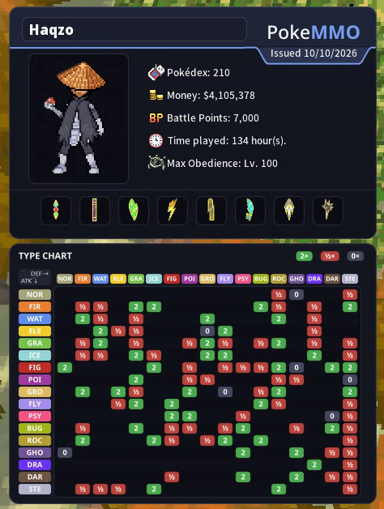
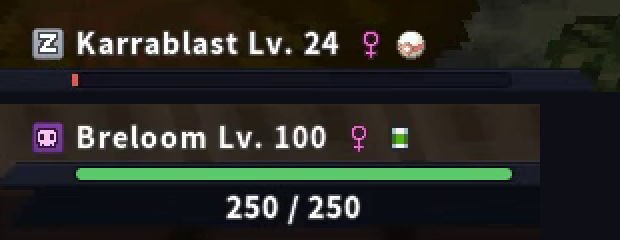
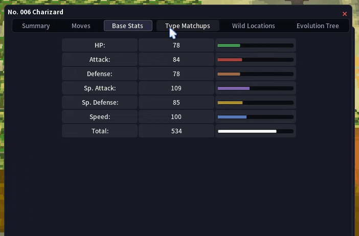
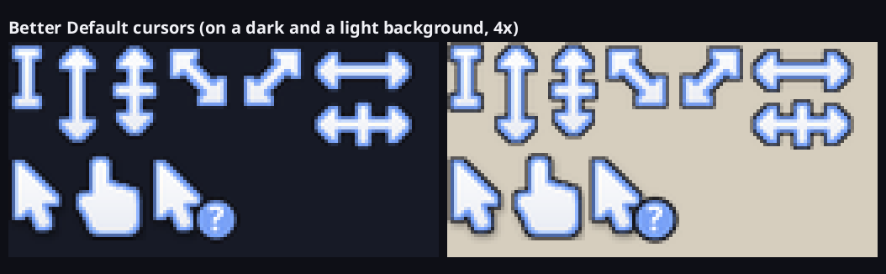
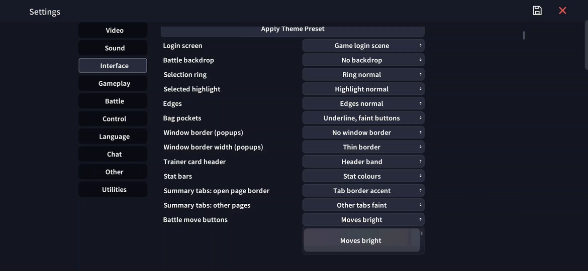

# Better Default 1.8.0 — new icons, cursors and settings

**New icons, Gift Shop labels, Better Default cursors and two new settings, plus a Mobile Beta update: one file for Android and iPhone / iPad.**

## Downloads

| File | For |
|---|---|
| `Better-Default-1.8.0.mod` | **PC** |
| `Better-Default-1.8.0-Mobile-Beta.zip` | **Phones and tablets, Android and iPhone / iPad — BETA**. The `.zip` is the mod itself: import it as it is, don't unzip it. |

Enable only **one** Better Default mod at a time.

## What's new

### PC and phones
- **Status icons** (frozen, paralysis, burn, poison, sleep, badly poisoned) are small tags in the 1.7.0 type-tag style: colour tile, soft gradient, dark edge, white symbol.
- **Gender, season and time-of-day icons** are cleaner, with soft shading. Same shapes and sizes as the game's.
- **Gift Shop:** NEW / LIMITED / ON SALE / SEASONAL are type-tag style labels instead of the hanging ribbons, in all 8 Gift Shop languages.
- **New setting – Trainer card header:** *Header band* (the top of the card in the Trainer card date band colour) or *Plain card*.
- **New setting – Stat bars** (Pokédex › Base Stats): *Stat colours*, *Soft colours* or *Accent bars* (Total stays white).
- **Better Default preset:** No backdrop and "Underline, faint buttons" bag pockets are the new defaults (PC also Bag height 658 and Pokédex height 530). Already installed? Pick **Better Default** and press **Apply Theme Preset**.

### PC
- **Better Default cursors** (arrow, hand, text, help, resize), inspired by Bibata Modern Ice: rounded, white with a blue border and a soft shadow.
- **Type chart:** new choice **Always show** — the chart stays open under your trainer card.
- **75 options:** 61 colours + 14 settings.

### Mobile Beta
- **One file for Android and iPhone / iPad:** `Better-Default-1.8.0-Mobile-Beta.zip` (an iPhone couldn't import the 1.7.5 `.mod`).
- Only the phone theme is inside, so phones no longer show *"Could not load theme Better Default because it is not a mobile theme"*.
- **Battle backdrop** is now a phone setting too (*No backdrop* removes the dark panel behind the battle messages).
- Trainer card header, Stat bars, the new icons and the Gift Shop labels work on phones as well.
- **70 options:** 57 colours + 13 settings.

### Known beta limits (phones)
- Tested on Android. iPhone / iPad: not confirmed yet — feedback welcome.
- The movement pad, the battle item bar and some popups are placed by the game; a theme can't move them.
- Type and move tags can only be smoothed, not made sharper: the game draws them at their own pixel size on phones.
- In the left battle column the type tag sits close to the button edge.

## Install / update

**PC**
1. Close PokeMMO. Delete older Better Default `.mod` files from `<PokeMMO>/data/mods/`.
2. Copy `Better-Default-1.8.0.mod` into `<PokeMMO>/data/mods/` (don't unzip it).
3. Start PokeMMO → **Mod Management** → enable **Better Default**.
4. **Settings → Interface → Theme:** pick **Better Default**, then **Apply Theme Preset** once.

**Phone / tablet (beta)**
1. Save `Better-Default-1.8.0-Mobile-Beta.zip` on your phone. Don't unzip it (on iPhone, don't tap it in Files).
2. PokeMMO → **Mod Management → Import Mod** → pick the `.zip`. Remove or disable other Better Default mods.
3. Enable **Better Default**.
4. **Settings → Interface → Theme:** pick **Better Default (Mobile Beta)** and restart.
5. Press **Apply Theme Preset** once.

## Credits
Better Water Levels (Fancy) by **Pancho412** — built in and recoloured to match Better Default ([original](https://forums.pokemmo.com/index.php?/topic/187702/)).

Full changelog: [CHANGELOG.md](https://github.com/haqzo/better-default/blob/main/CHANGELOG.md)
