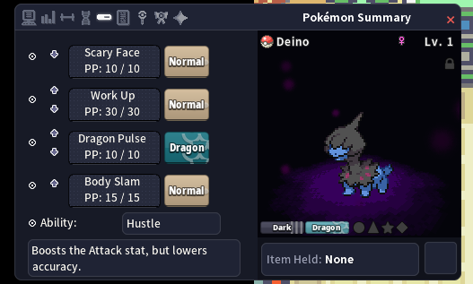
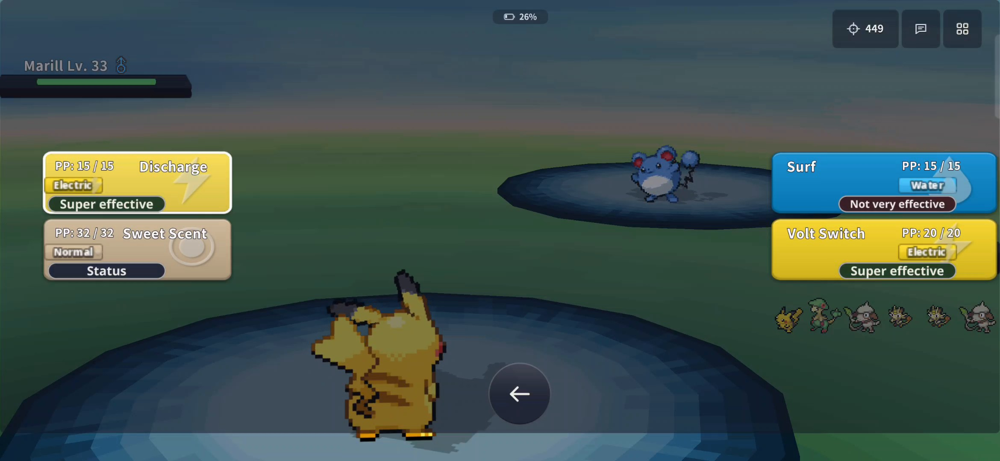
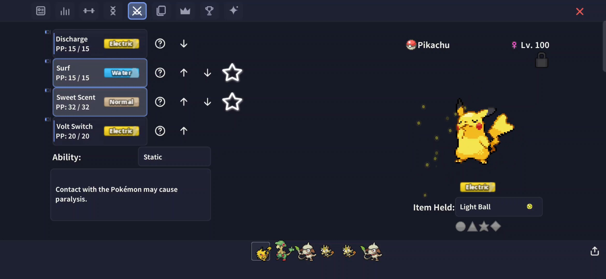

# Better Default 1.7.5

PokeMMO's default theme, cleaned up and restyled to match the newer HUD while keeping the familiar layout. Better Default includes **13 presets**, an integrated **Type Chart**, and **73 customization options** — 61 colour options and 12 additional settings — all in one theme.

**New in 1.7.5: Better Default for phones and tablets (Mobile Beta)** — a separate download, see [Mobile Beta](#mobile-beta) below.

## Download

Get the latest `.mod` files from the [GitHub Releases page](https://github.com/haqzo/better-default/releases/latest):

| File | For |
|---|---|
| `Better-Default-1.7.5.mod` | **PC** |
| `Better-Default-1.7.5-Mobile-Beta.mod` | **Phones and tablets — BETA** |

Enable only **one** Better Default `.mod` at a time.

## Install / update (PC)

1. Close PokeMMO.
2. Place the downloaded `.mod` file in `<PokeMMO>/data/mods/`. **Do not unzip it.**
3. Start PokeMMO and open **Mod Management**. Enable Better Default.
4. Go to **Settings → Interface → Theme** and select **Better Default**.
5. Open **Settings → Interface → Theme Settings** to customize the theme and choose a preset.
6. Press **Apply Theme Preset** after updating, so the new settings receive the selected preset's values.
7. Restart PokeMMO if prompted.

When updating, remove older Better Default `.mod` files from the mods folder first so you don't accidentally enable an outdated copy.

## Theme settings

There is just **one theme: Better Default**. Its appearance is controlled through **Settings → Interface → Theme Settings**, so you can customize the look without switching between separate theme versions.

- **Battle backdrop:** choose **Battle band** (the dark band behind battle buttons and messages) or **No backdrop**.
- **Login screen:** choose **Better Default backdrop**, **Better Default backdrop (no sparkles)**, or **Game login scene** (PokeMMO's own animated login scene).
- **Type Chart:** show the integrated Type Chart when hovering over your Trainer Card name, or turn it off.
- **Bag pocket style:** choose from seven selection styles — Pill, Underline, Underline with faint buttons, Underline only, Pill + underline, Accent ring, or Accent ring + underline.
- **Window borders:** choose No border, Faint, Medium, or Strong, with Thin or Thick width and a customizable border colour.

### Customization

Better Default has **73 options in total**:

- **61 colour options** for the theme's interface colours.
- **12 additional settings** for elements such as the battle backdrop, login screen, Type Chart, Bag pocket style, window borders, encounter counter, Bag and Pokédex heights, selection ring, selected highlight, and window/panel edges.

All **13 presets** set the theme options, so you can start with a preset and customize from there.

### Presets

- Better Default
- PokeMMO Gold
- Amethyst
- Emerald
- Sakura
- Ember
- Arctic
- Crimson
- Graphite
- OLED Black
- Catppuccin Mocha
- Tokyo Night
- Better Default + high-contrast bars

Existing presets have also been refined. PokeMMO Gold now uses the game's own gold, Amethyst is deeper purple, Emerald is greener, Sakura is softer pink, Ember is more orange, Crimson is deeper red, and OLED Black now uses true black windows.

## Mobile Beta

Better Default now has a version for **phones and tablets**. It is still a **beta**, so it comes as its own file: `Better-Default-1.7.5-Mobile-Beta.mod`.

It uses the game's own phone layout (big touch buttons, full-screen windows), drawn in the Better Default style with the same colours and the same 13 presets as on PC.

### Install (phone / tablet)

1. Download `Better-Default-1.7.5-Mobile-Beta.mod` to your phone. **Do not unzip it.**
2. In PokeMMO open **Mod Management → Import Mod** and pick the file. Remove or disable other Better Default mods.
3. Enable **Better Default**.
4. Go to **Settings → Interface → Theme**, select **Better Default (Mobile Beta)** and restart.
5. Press **Apply Theme Preset** once.

### What's drawn for the phone

- **Full-screen windows** also fill the strip under the game area, so there's no black band at the bottom of the screen.
- **Rounder corners** made for touch, and the new HUD's **line icons** on the phone buttons.
- **Pokémon Summary:** tab buttons with icons (the open page is a bright tile with an Accent border, the others are faint), dark patterned move cards with an Accent stripe, and a small gap between the value boxes.
- **Battle:** move buttons as big type tags (type colour, soft gradient, type symbol); sharp effectiveness labels (Super effective, Effective, Not very effective, Immune, Status) that fit inside their pill; round battle buttons with the HUD's icons; an item description panel in the battle Bag.
- Smoothly scaled type and move tags, rounded checkboxes, the chat window in the Chat background colour, more padding on Gift Shop cards, and the Fancy berry water drops like on PC.

### Mobile settings

**67 options: 57 colours + 10 settings**, and all 13 presets. Only settings that change something on a phone are listed; the PC-only ones (Bag height, Pokédex height, Battle backdrop, Encounter counter style and its colours, Type chart, Summary item bar) are left out. Window border and Window border width are called *(popups)* on phones, because they only show on popups and NPC dialogue there.

Phone-only settings:

- **Summary tabs: open page border:** Tab border accent / Tab border soft / Tab border off.
- **Summary tabs: other pages:** Other tabs faint / Other tabs solid / Other tabs icons only.
- **Battle move buttons:** Moves bright / Moves deeper / Moves dark.

### Known beta limits

- Tested on Android. iPhone / iPad have not been tested yet.
- The movement pad, the battle item bar and some popups are placed by the game; a theme can't move them.
- Type and move tags can only be smoothed, not made sharper: the game draws them at their own pixel size on phones.
- After switching themes you may see "Could not load theme Better Default because it is not a mobile theme" once — pick **Better Default (Mobile Beta)** in Settings → Interface → Theme and restart.

Feedback and phone screenshots are very welcome.

## Better Items

**Better Items**, my separate item-icon mod, works great alongside Better Default. The two mods complement each other visually, but they also work independently — you can use Better Items with other themes too.

- [Better Items on GitHub](https://github.com/haqzo/better-items-)
- [Better Items forum thread](https://forums.pokemmo.com/index.php?/topic/201627/)

## What's new in 1.7.5

- **New: Better Default Mobile (Beta)** for phones and tablets, as a separate download (see [Mobile Beta](#mobile-beta)).
- **PC:** no changes — the PC theme is the same as in 1.7.0.

## 1.7.0

### Redesigned Type & Move Tags

- Completely redrawn Type, Move, and Damage Class tags (Physical, Special, and Status).
- Updated in all seven supported languages: English, German, Spanish, French, Italian, Korean, and Chinese.
- Official type colours, soft gradients, modern symbols, and improved readability.
- In Pokémon Summary, move tags are now as tall as the move boxes and sit directly beside them, with move names centered.

### New customization options

- Added seven Bag pocket selection styles.
- Added customizable Window Borders with four styles: No border, Faint, Medium, and Strong.
- Added Thin and Thick border widths, plus a new Window border colour option.
- Added an option to show the integrated Type Chart when hovering over your Trainer Card name, or turn it off.

### Presets

- Added two new presets: **Catppuccin Mocha** and **Tokyo Night**.
- Refined the colours of existing presets, including true black windows for OLED Black.

### Icon and interface improvements

- Redrawn small interface icons such as settings, trash, lock, pin, and sort icons.
- Updated pixel icons — including BP, coins, clock, seasons, shiny stars, Alpha, hordes, and status icons — to match the cleaner Better Items look.
- Updated the Login Screen logo with the same bold, condensed typography used by the tags.
- Made the Bag pocket row taller and centered its icons.
- Widened Pokémon Summary by 4px to better fit shiny star, Alpha, and Hidden Ability badges.
- Improved the alignment of the Item Held tile and bar.
- Updated GTL item icons to use the same tile style as Bag slots.
- Poké Mart item names now stop before the item icon instead of running underneath it.

## Previous updates

### 1.6.5

- Moved Bag pockets into one top tab bar and added separate **Bag header** and **Bag window** colour options.
- Updated battle effectiveness labels with white text, softer colours, and a new **Effectiveness text** option.
- Polished spacing and alignment in the Pokédex, Mail, Egg Incubators, and PC.
- Added Encounter counter style, Bag height, Pokédex height, Selection ring, Selected highlight, and Edges settings.
- Expanded customization to 68 options: 60 colours and 8 settings.

### 1.6.0

Updated Better Default for **PokeMMO theme revision 11**, restoring compatibility with the game update and incorporating its refreshed fonts, HUD fonts, HUD atlas, widgets, and mail reward slot.

- Improved Pokémon Summary styling and layout.
- Refined PC Deposit Box positioning and window styling.
- Fixed Gift Shop Buy button sizing.
- Improved login menu button spacing.
- Adjusted Settings → Other column widths.
- Added spacing between Battle Bag item rows.
- Enlarged GTL page buttons.

### 1.5.5

- Moved Bag pockets into one top tab bar and added separate **Bag header** and **Bag window** colour options.
- Updated battle effectiveness labels with white text, softer colours, and a new **Effectiveness text** option.
- Polished spacing and alignment in the Pokédex, Mail, Egg Incubators, and PC.

### 1.5.0

Version 1.5.0 introduced 20 new colour options (36 → 56), redesigned tab bars and progress bars, a restyled Trainer Card and Pokémon Summary, login sparkles, a themed Contest screen, and the integrated Type Chart.

## Credits

- **Better Water Levels (Fancy)** by Pancho412 — included and recoloured to match the theme; the layout is unchanged.
- Theme foundation: **PokeMMO Default Theme**.
- **Poke-Manager** support by TheMatthew562. [Poke-Manager forum thread](https://forums.pokemmo.com/index.php?/topic/174159-ryukotsukis-poke-manager/).
- [Better Water Levels forum thread](https://forums.pokemmo.com/index.php?/topic/187702-pc-mobile-better-water-levels/).

## Changelog

See [CHANGELOG.md](CHANGELOG.md) for the full version history.
