# Better Default 🌟

**A complete UI restyle for PokeMMO – bringing the entire interface in line with the new HUD.**

When the new HUD dropped on October 30th, I immediately loved its clean and modern look. However, I noticed that the rest of the interface still felt like the original game.

Opening the Bag, Pokédex, Pokémon Summary or entering a battle felt like switching between two different interfaces.

So I decided to change that.

**Better Default brings the entire PokeMMO interface together**, restyling the original UI to match the new HUD while keeping the familiar default layout intact.

No rearranging windows, no relearning menus and no unnecessary changes to how you play. Just a more consistent visual experience.

**Latest version: 1.1.0** · [Download](https://github.com/haqzo/better-default/releases/latest) · [Forum thread](https://forums.pokemmo.com/index.php?/topic/201443-pc-better-default-the-whole-ui-restyled-to-match-the-new-hud-%F0%9F%8E%83-updated-for-halloween-%F0%9F%8E%83/)

---

## 📸 Showcase

### Login Screen
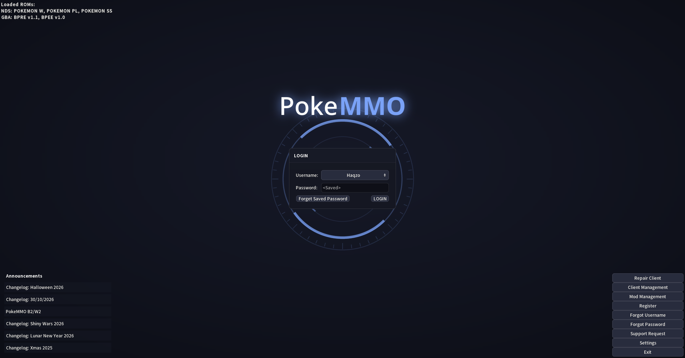

### Battle
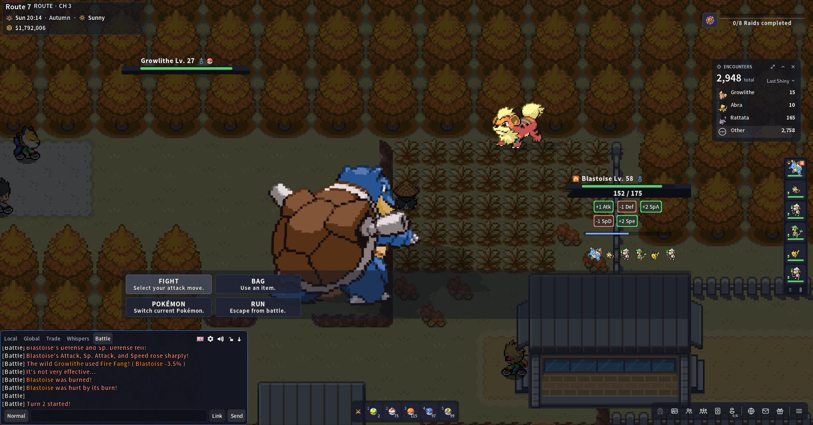
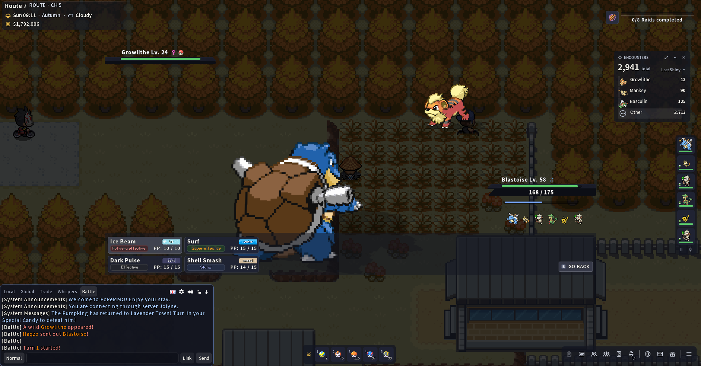
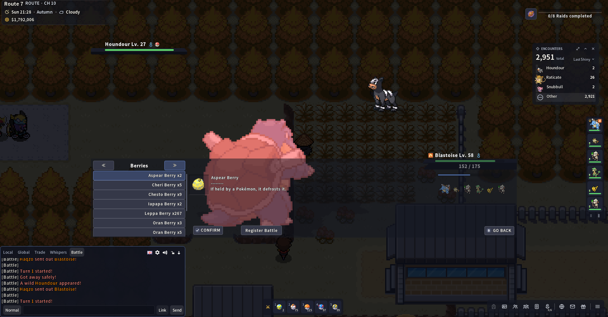
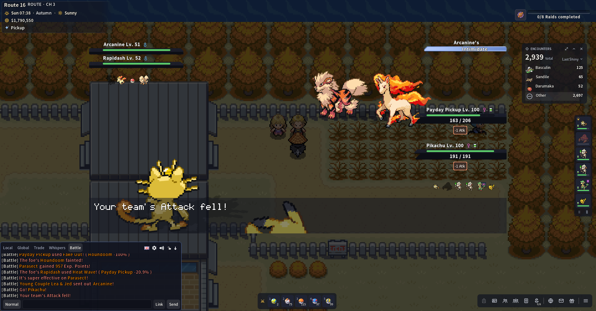
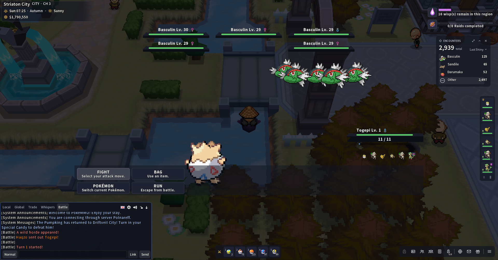

### PC & Egg Incubators
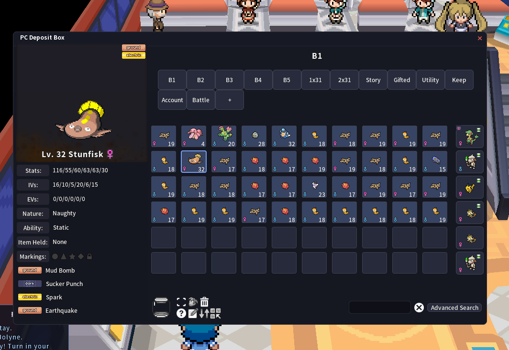
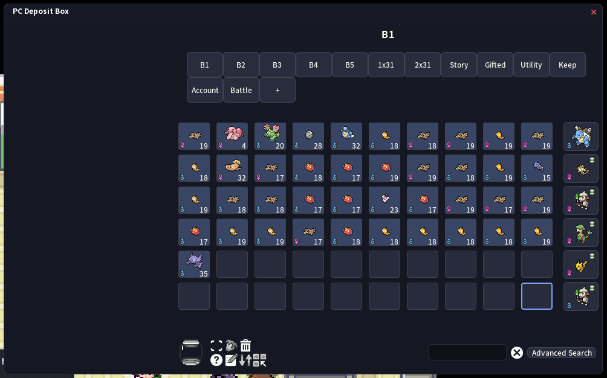
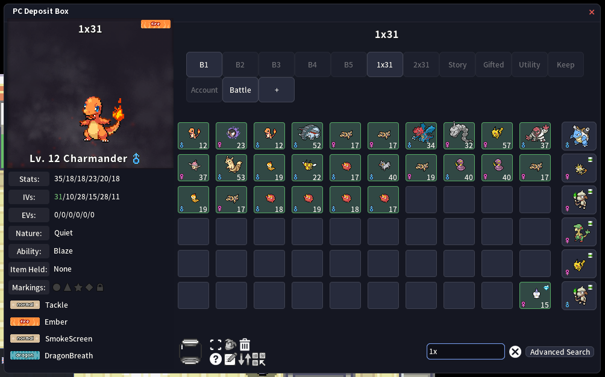
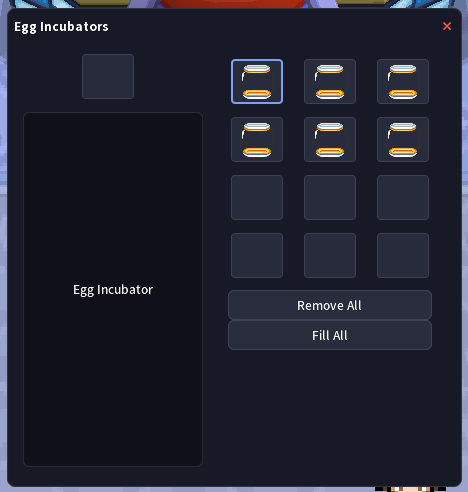

### Pokémon Summary & Pokédex
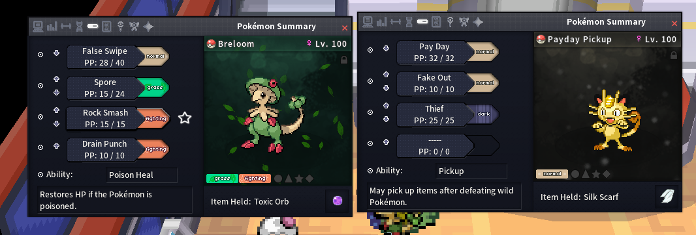
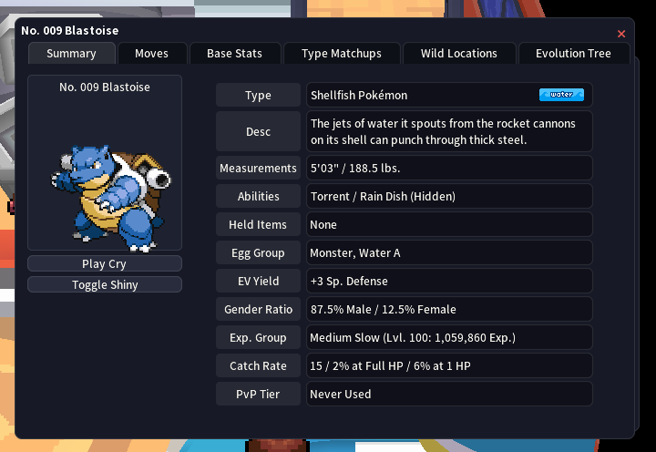

### Trainer Card + Type Chart
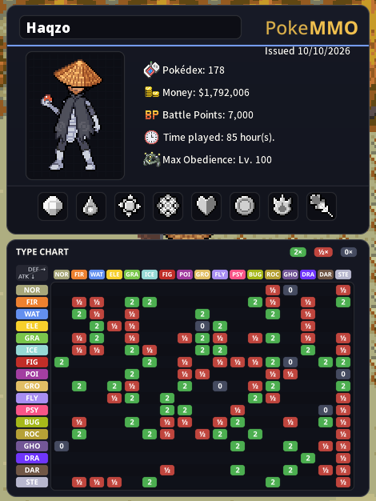

### Overworld, Bag & Settings
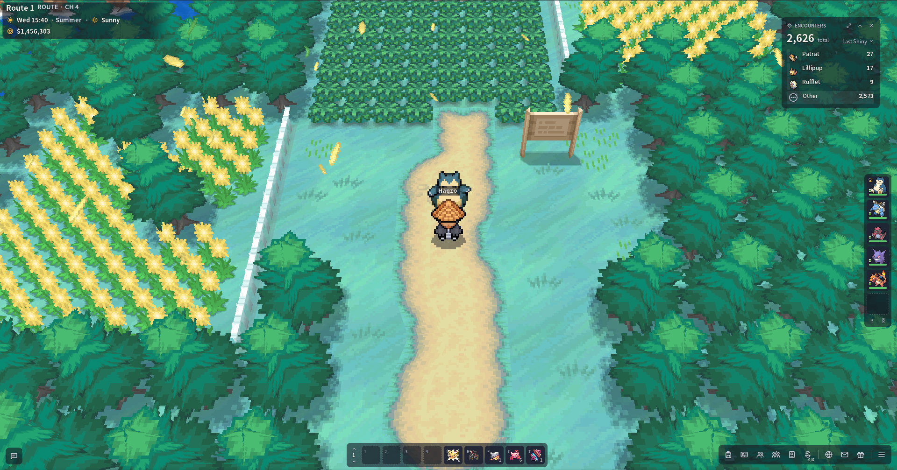
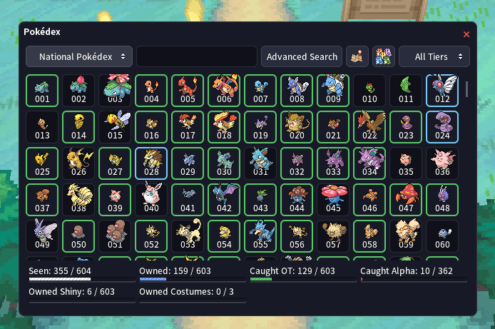
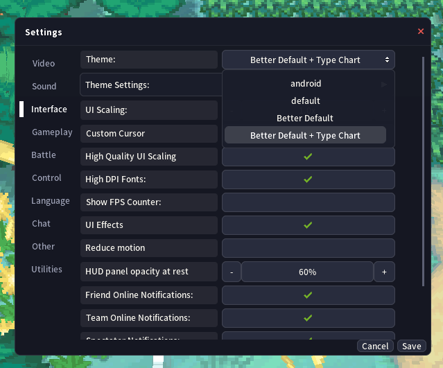

---

## ✨ What's Changed?

The goal was to make the entire interface feel like one cohesive design.

- **Windows, menus & popups:** Rounded panels, thin borders and clean title dividers.
- **Buttons, tabs & lists:** Consistent flat styling; hover and selected states use your Accent colour.
- **Close buttons:** Clear red X buttons across all windows.
- **Top HUD:** Location, time and money displayed on a glass-style panel for better readability.
- **Battle UI:** Dark glass nameplates with softened corners, pill-shaped HP/EXP bars, an ability banner in your Accent colour, clean stat badges (+1 Atk / -1 Def), flat Back / Confirm / Register Battle buttons and colour-coded effectiveness labels.
- **Battle Bag:** Flat item list with the selected item in your Accent colour, centred page arrows that light up on hover and an outline-only look when you can't page further.
- **PC & Egg Incubators:** Flat rounded slots; selection and cursor in your Accent colour, search matches in soft green.
- **Pokémon Summary:** Cleaner tab icons with an illuminated selected state, flat dot-grid move buttons.
- **Pokédex:** The Pokémon sprite sits in a clean rounded card.
- **Trainer Card:** Redesigned to fit the overall theme.
- **Login Screen:** Solid background with a slowly rotating emblem behind the login window and a clean PokeMMO logo.
- **Tooltips, chat bubbles & NPC dialogue:** Restyled with matching dark panels.
- **Berry Farming:** Improved water drops, courtesy of Pancho412 (see credits).

---

## 🎨 Fully Customizable

**Settings → Interface → Theme Settings**

Better Default includes extensive customization options, allowing you to create your own look without modifying theme files. New elements follow these options too – for example, the ability banner, PC selection, list highlights and battle buttons all follow your **Accent** and **Battle plates & buttons** colours.

**36 colour options**, covering:

- Accent colours
- Window backgrounds
- Buttons and borders
- Text colours
- HUD panels
- Encounter counter
- Battle interface
- HP bars and more

**11 built-in presets:**

1. Better Default
2. PokeMMO Gold
3. Amethyst
4. Emerald
5. Sakura
6. Ember
7. Arctic
8. Crimson
9. Graphite
10. OLED Black
11. Colourblind-friendly HP bars

---

## 📊 Optional: Better Default + Type Chart

There's also an optional version of the theme!

Selecting **Better Default + Type Chart** from the theme list adds a type chart underneath your Trainer Card.

- Covers all 17 PokeMMO types.
- Checked against the PokeMMO Wiki.
- Integrated into the theme's visual design.

---

## 📋 Changelog

### Version 1.1.0 – The Modern Update ✨

**Battle**
- Softened corners on all battle nameplates (single, double, horde and raid).
- HP and EXP bars are now rounded pills with a thin border – still readable at 1 HP.
- The ability banner (e.g. "Breloom's Poison Heal") follows your Accent colour.
- Stat badges (+1 Atk / -1 Def) keep an even border at any width; boosts are green, drops are red.
- Back, Confirm and Register Battle buttons are flat like FIGHT / BAG, with an Accent outline on hover.
- Battle bag: flat item list, selected item in your Accent colour, centred page arrows that light up on hover and an outline-only look when you can't page further.

**Windows**
- PC boxes & Egg Incubators: flat rounded slots instead of glows; selection and cursor in your Accent colour, search matches in soft green.
- Pokémon Summary: flat dot-grid move buttons with a rounded end; the highlighted move follows your Accent colour.
- Pokédex: rounded card around the Pokémon sprite.
- Shiny encounter window: dark header (the title was hard to read).
- Small list buttons (PC, Settings, Advanced Search…) share the new flat style.

**Other**
- Login screen: removed the line under the PokeMMO logo.
- The mod info now links to the forum thread.

### Version 1.0.1 – Halloween Update 🎃

- Updated the theme for the Halloween Event (theme revision 10).

### Version 1.0 – Initial Release

- Complete UI restyle to match the new HUD.
- Added 36 customizable colour options.
- Added 11 built-in colour presets.
- Redesigned Battle UI, Trainer Card and Pokémon Summary.
- Updated windows, menus, buttons and popups.
- Added optional Better Default + Type Chart version.

---

## 🛠️ In Development & Future Plans

### ✅ Done in 1.1.0
- [x] Cleaner Battle HUD, HP and XP bar.
- [x] Remove the blue underline on the login screen under the PokeMMO logo.
- [x] Cleaner Pokémon Summary.
- [x] More modern buttons and highlight/hover states.

### 💡 Future Ideas
- [ ] Even more customization: colour options for the newest elements (PC search highlight, battle-box tint and more).
- [ ] Mobile version! *(Will take some time – not first priority.)*

*This section will be updated as development progresses. Ideas and planned features are subject to change.*

---

## 📥 Download & Installation

**Latest Version: 1.1.0**

[Download the latest release](https://github.com/haqzo/better-default/releases/latest)

### Installation

1. Download `Better-Default-1.1.0.mod`.
2. Place it inside `PokeMMO/data/mods/`. **Do not unzip it.** Remove any older Better Default `.mod` first.
3. Start PokeMMO and enable Better Default under Mod Management.
4. Navigate to **Settings → Interface → Theme**.
5. Select either Better Default or Better Default + Type Chart.
6. Restart the game.

### Poke-Manager Support

A big thanks to TheMatthew562 for making the theme available through Poke-Manager!

[Check out Ryukotsuki's Poke-Manager](https://forums.pokemmo.com/index.php?/topic/174159-ryukotsukis-poke-manager/)

---

## 💫 Credits & Thanks

### Pancho412 – Better Water Levels (Fancy)

The improved berry water drops included in Better Default come from Pancho412's Better Water Levels (Fancy) mod.

It's a great improvement for berry farming, and I wanted to include it in this theme.

Please check out the original work and show some support!

[Original Better Water Levels thread](https://forums.pokemmo.com/index.php?/topic/187702-pc-mobile-better-water-levels/)

**Theme foundation:** PokeMMO Default Theme.

---

## 💬 Feedback & Suggestions

If you encounter bugs, have suggestions or think something could be improved, feel free to leave a comment on the forum or open an issue here.

Screenshots of your custom colour combinations are also very welcome. I'd love to see what everyone comes up with!

**Enjoy Better Default! ✨**

---

**PokeMMO Forum Thread:** [Visit the official release thread](https://forums.pokemmo.com/index.php?/topic/201443-pc-better-default-the-whole-ui-restyled-to-match-the-new-hud-%F0%9F%8E%83-updated-for-halloween-%F0%9F%8E%83/)

— **Haqzo**
