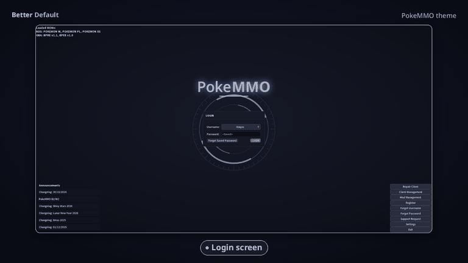

# Better Default 1.6.0

PokeMMO's default theme, cleaned up and restyled so the classic windows fit the newer HUD. Better Default has **11 presets**, an integrated **Type Chart**, and four theme variants with up to **59 colour options**.

## Download

Get the latest `.mod` file from the [GitHub Releases page](https://github.com/haqzo/better-default/releases/latest).

## Install / update

1. Close PokeMMO.
2. Place the downloaded `.mod` file in `<PokeMMO>/data/mods/`. **Do not unzip it.**
3. Start PokeMMO and open **Mod Management**. Enable Better Default.
4. Go to **Settings → Interface → Theme** and choose the variant you want.
5. Restart PokeMMO if prompted.

When updating, remove older Better Default `.mod` files from the mods folder first so you don't accidentally enable an outdated copy.

## Theme variants

- **Better Default** — the standard theme, with 59 colour options.
- **Better Default (no backdrop)** — removes the battle backdrop, with 59 colour options.
- **Better Default (game login)** — uses the original animated game login scene, with 57 colour options.
- **Better Default (no backdrop, game login)** — combines the no-backdrop battle layout with the original game login scene, with 57 colour options.

All variants include the integrated Type Chart. Hover over your trainer name on the Trainer Card to view it; you no longer need a separate Type Chart theme.

## What's new in 1.6.0

**Compatibility and polish.** Updated Better Default for the current PokeMMO theme revision 11, including refreshed fonts, HUD fonts, HUD atlas, widgets, and the mail reward slot.

### Pokémon Summary
- Rounded the window and added a faint edge.
- Added a rounded display area for the Pokémon, with a soft rim, matching the Item Held bar.

### PC
- Moved the Deposit Box contents 10px lower to clear the title bar.
- Added rounded corners and a faint border to the Deposit Box.

### Other improvements
- **Gift Shop:** Buy buttons on sprite cards now match the other cards.
- **Login:** Added a 4px gap between side-menu buttons.
- **Settings → Other:** Narrowed value columns so they fit the window better.
- **Battle Bag:** Added a 4px gap between item rows.
- **GTL:** Slightly enlarged the page buttons.

No new colour options or presets were added in this update.

## Previous update — 1.5.5

### Bag
- Bag pockets now use one top tab bar, matching the other windows.
- The selected pocket is raised, with centered icons and no gaps showing the world behind the tabs.
- Added separate **Bag header** and **Bag window** colour options.

### Battle
- Effectiveness labels now use white text: **Status**, **Effective**, **Not very effective**, **Super effective**, and **No effect**.
- The effectiveness colours have been softened, with a subtle glowing rim.
- **Effective** is no longer greyed out.
- Added an **Effectiveness text** colour option.

### Alignment and polish
- Aligned the Pokédex Wild Locations season tabs.
- Adjusted Mail checkbox spacing and the position of names and subjects.
- Added more space between the Egg Incubators buttons.
- Adjusted PC box-button spacing and evenly spaced Pokémon slots.

### Login themes
The two game-login variants use PokeMMO's original animated login scene. The login background and sparkle options are not included in those variants.

### Options and presets
- **59 colour options** in the standard variants and **57** in the game-login variants.
- **3 options** added in 1.5.5: Bag window, Bag header, and Effectiveness text.
- All **11 presets** are set up across all four variants.

## Earlier major update — 1.5.0

Version 1.5.0 introduced 20 new colour options (36 → 56), redesigned tab bars and progress bars, a restyled Trainer Card and Pokémon Summary, login sparkles, a themed Contest screen, and the integrated Type Chart. It also introduced the no-battle-backdrop variant.

## Credits

- **Better Water Levels (Fancy)** by Pancho412 — included and recoloured to match the theme; the layout is unchanged.
- Theme foundation: **PokeMMO Default Theme**.
- **Poke-Manager** support by TheMatthew562. [Poke-Manager forum thread](https://forums.pokemmo.com/index.php?/topic/174159-ryukotsukis-poke-manager/).
- [Better Water Levels forum thread](https://forums.pokemmo.com/index.php?/topic/187702-pc-mobile-better-water-levels/).

## Changelog

See [CHANGELOG.md](CHANGELOG.md) for the full version history.
